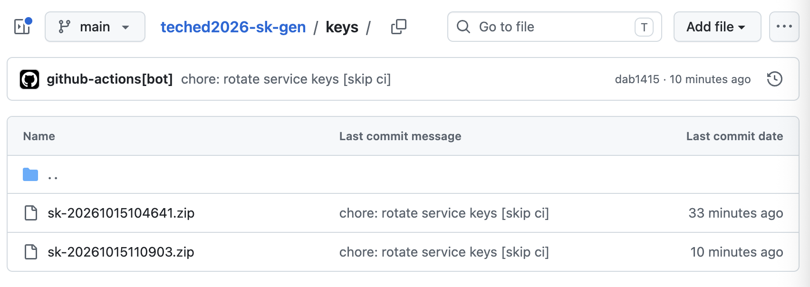
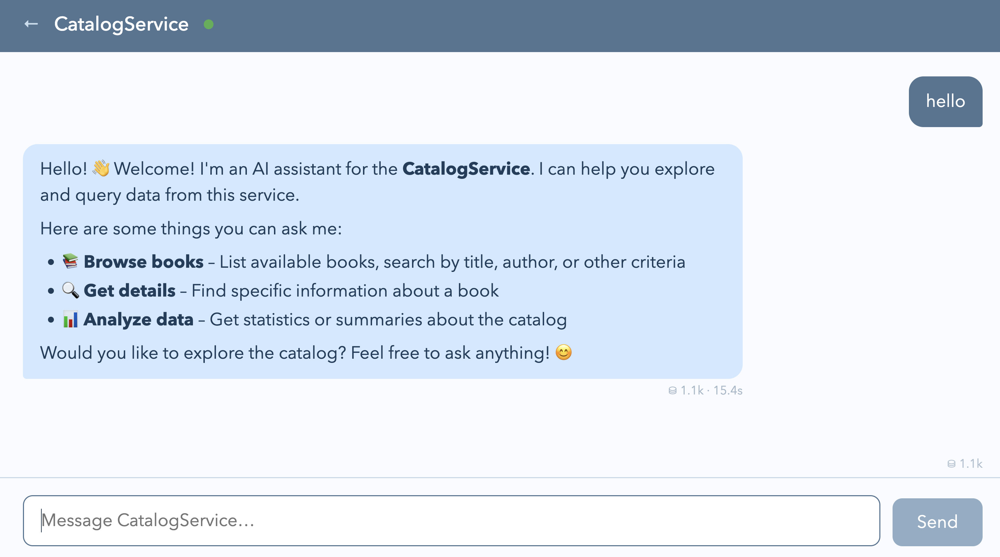

# Connect a CAP-level agent to AI Core

<!-- description --> See the power of CAP-level agents when connected to SAP AI Core.

## You will learn

- One way of configuring your CAP-level agent to be able to connect to an AI Core instance

## Prerequisites

_This is a special tutorial, to be used in the Developer Garage on the show floor
at SAP TechEd 2026 in Berlin. We plan to replace this tutorial with an extended one
on the same topic after the TechEd season is over._

This tutorial is designed to follow directly on from the [Create an agent from
a CAP service](https://developers.sap.com/tutorials/cap-create-agent) tutorial,
which is therefore the main prerequisite here. In other words, remain in the
development environment you are still in from that previous tutorial, and stay
in the `cap-create-agent/` project directory from there.

## Intro

CAP-level agents can be configured in different ways to use LLMs, as described in the
[CAP-level Agents](https://cap.cloud.sap/docs/guides/ai/cap-agents) guide in Capire.

Following the CAP philosophy of local-first development and the "hybrid"
approach which combines the best of both worlds, one way of moving from the
mocked LLM that we saw in the previous tutorial to a real LLM is to run the
agent locally but connect remotely to an instance of the [SAP AI
Core](https://help.sap.com/docs/sap-ai-core/sap-ai-core-service-guide/what-is-sap-ai-core)
service.

In this tutorial we'll configure such a connection, using an approach to supply
credentials with a convenient feature from the [SAP Cloud SDK for
AI](https://sap.github.io/ai-sdk/), a package which the CAP-level agents plugin
`@cap-js/agents` uses.

---

### Step 1 Set the LLM configuration for AI Core use

We can [configure the LLM used by an
agent](https://cap.cloud.sap/docs/guides/ai/cap-agents#cdsrequiresllm) via
`cds.requires.llm`. By default, the value (technically for
`cds.requires.llm.kind`) in development mode is `auto`. In the previous
exercise we explicitly set it to `mock`, using a process-specific environment
variable like this: `cds_requires_llm_kind=mock cds watch`.

For this tutorial, we'll set it to `aicore`. There are many places that are
treated as [sources for the effective
environment](https://cap.cloud.sap/docs/node.js/cds-env#sources-for-cdsenv)
beyond the process-specific environment variable used last time. This time
we'll use a `.env` file in the project directory here.

👉 First, stop any CAP server that might still be running from a previous
tutorial.

👉 Next, in the `cap-create-agent/` directory (see the Prerequisites section above),
add the following to a new file `.env`:

```text
cds.requires.llm.kind=aicore
cds.requires.llm.resourceGroup=codejam-genai
```

> A note on the `resourceGroup` setting:
>
> In SAP AI Core, [resource
> groups](https://help.sap.com/docs/sap-ai-core/generative-ai/manage-resource-groups)
> are unique workspace environments with their own specific configuration,
> artifacts and more.  SAP AI Core's "extended" service plan is required for agent use,
> as it makes access available to foundation models and Generative AI Hub features.
>
> So for this sort of CAP-level agent setup with an LLM provided via SAP AI Core,
> a resource group that has been set up in the context of the "extended" plan is
> required.
>
> For the purposes of this tutorial at SAP TechEd 2026 in Berlin, we have made
> available an SAP AI Core instance, with such a resource group called
> `codejam-genai`; some of you may recognise this from one of the CodeJams run
> by the Developer Advocates.

### Step 2 Try out the agent to LLM connectivity

👉 Restart the CAP server with `cds watch`, and observe the log output, which
should now include a section that looks like this:

```log
[agents] - cds.connect.to 'llm' with: {
  impl: '@cap-js/agents/lib/models/aicore',
  model: 'anthropic--claude-4.6-sonnet',
  contentFilter: true,
  kind: 'aicore',
  resourceGroup: 'codejam-genai',
  credentials: {}
}
```

👉 Now access the agent preview by following the `http://localhost:4004` URL
from the CAP server log output & selecting the "Preview" link again, and send a
message. A response will be forthcoming, but it shows we're not quite there
yet:


That makes sense, as we haven't specified any credentials for the AI Core
connection.

### Step 3 Add credential information

> Just a reminder that this tutorial is currently only designed for use
> at the Developer Garage at SAP TechEd 2026 in Berlin.

Credentials for such a connection can be provided in various ways. One of the
more straightforward approaches, which is especially helpful in starter
scenarios like this - where a simple approach to a hybrid setup is desired - is
to [use the environment variable
AICORE_SERVICE_KEY](https://sap.github.io/ai-sdk/docs/java/connecting-to-ai-core#using-the-aicore_service_key-environment-variable).
Because the CAP-level agents plugin (`@cap-js/agents`) makes use of the [SAP
Cloud SDK for AI](https://sap.github.io/ai-sdk/docs/js/overview) package,
supplying service key details via `AICORE_SERVICE_KEY` will work just fine.

There are temporary (limited lifetime) service keys available for your use
at the Developer Garage during SAP TechEd 2026 in Berlin. In this step, you'll
retrieve such a service key, and set it in the `AICORE_SERVICE_KEY` environment
variable.

The keys are available in a GitHub repo, and are rotated (old ones expired, new
ones minted) on a regular basis. They can be found in the
[keys/](https://github.com/SAP-samples/teched2026-sk-gen/tree/main/keys)
directory of the `SAP-samples/teched2026-sk-gen` repo on GitHub, stored in
password-protected ZIP files, which are suffixed with a timestamp
(YYYYMMDDHHMMSS), like this:



#### Retrieve a temporary service key

👉 Head over to the
[keys/](https://github.com/SAP-samples/teched2026-sk-gen/tree/main/keys)
directory in this repo, and **download the latest (most recent) one** - they
will be listed by default with the most recent one at the bottom, as shown in
the screenshot example.

👉 Then use `unzip` to unpack the file, which should contain a single file with
the same name, but with a `.json` extension. Here's an example of how to do
that, with the latest file in the list shown in the screenshot:

```shell
$ unzip sk-20261015110903.zip
Archive:  sk-20261015110903.zip
[sk-20261015110903.zip] sk.json password:
  inflating: sk.json
```

> 🔐 You will need a password - please ask one of the Developer Advocates
> staffing the Developer Garage, and they will tell you.

#### Examine the service key contents

👉 Just to check, have a look at the contents of the JSON file you just
unpacked; you should see something like this:

```json
{
  "appname": "e7137a89-ec15-46ff-910e-decafbad",
  "clientid": "sb-e7137a89-ec15-46ff-910e-decafbad",
  "clientsecret": "d91be6a5-082f-447c-a2c9-decafbad",
  "credential-type": "binding-secret",
  "identityzone": "genai-codejam-zuyq1wkg",
  "identityzoneid": "a5a420d8-58c6-4820-ab11-decafbad",
  "serviceurls": {
    "AI_API_URL": "https://api.ai.prod.eu-central-1.aws.ml.hana.ondemand.com"
  },
  "token-type": [
    "xsuaa"
  ],
  "url": "https://genai-codejam-zuyq1wkg.authentication.eu10.hana.ondemand.com"
}
```

This is a temporary service key for an AI Core instance, the credentials that
correspond to the `cds.requires.llm` configuration that we set earlier.

#### Store the contents in AICORE_SERVICE_KEY

Storing this as-is in an environment variable is problematic, as the value
spans multiple lines. But we can store it in compacted form - as a single long
line. For this, we can use [jq](https://jqlang.org/)'s `--compact-output`
option in conjunction with the identity function (`.`), like this:

```bash
jq -c . sk.json
```

This will emit something like this (shown here split across multiple lines for
readability):

```json
{"appname":"e7137a89-ec15-46ff-910e-decafbad","clientid":"sb-e7137a89-ec15-46ff-
910e-decafbad","clientsecret":"d91be6a5-082f-447c-a2c9-decafbad","credential-typ
e":"binding-secret","identityzone":"genai-codejam-zuyq1wkg","identityzoneid":"a5
a420d8-58c6-4820-ab11-decafbad","serviceurls":{"AI_API_URL":"https://api.ai.prod
.eu-central-1.aws.ml.hana.ondemand.com"},"token-type":["xsuaa"],"url":"https://g
enai-codejam-zuyq1wkg.authentication.eu10.hana.ondemand.com"}
```

👉 Using this technique, store the service key in `AICORE_SERVICE_KEY` like
this:

```shell
export AICORE_SERVICE_KEY="$(jq -c . sk.json)"
```

You can check if this has been successful by running `env`, to show all
environment variables, or by using `echo $AICORE_SERVICE_KEY`.

#### (Optional)

If you're interested, rather than doing all of this manually as described, you
can act like your agentic assistant and simply use the power of the command line:

```shell
d=$(mktemp -d -p /tmp/) \
  && git clone --quiet https://github.com/SAP-samples/teched2026-sk-gen "$d" \
  && find "$d/keys/" -name 'sk-*.zip' \
  | sort -n -t- -k2 \
    | tail -1 \
    | xargs unzip -o \
  && export AICORE_SERVICE_KEY="$(jq -c . sk.json)"
```

💪

### Step 4 - Retry with the configuration and credentials

With the configuration and the service key credentials in place, we're ready to
give it another go.

👉 Restart the CAP server with `cds watch`, and wait for the startup, where you
should see a `cds.connect.to` section in the log output, as before.

👉 Revisit the agent preview and send another message. This time, an
agent-appropriate response should be returned.

Great! This is the CAP-level agent, built from the `CatalogService` in the
CDS model, with that single `@agent` annotation, using the AI Core instance to
access an LLM, with which it can complete its goal:



Congratulations - you also have completed _your_ goal, and are at the end of the
tutorial!

Before moving on to the wrap-up and question section, feel free to interact
with the agent about the books.

### Wrap-up and further info

This just scratches the surface when it comes to building CAP-level agents, LLM
connectivity, and more. Now you have a better understanding, it's worth a visit
to the [CAP-level Agents](https://cap.cloud.sap/docs/guides/ai/cap-agents)
guide in Capire.

We see in the [CAP-level
Agents](https://cap.cloud.sap/docs/guides/ai/cap-agents) guide that in addition
to just using the simple `@agent` annotation, we can add detailed information
about the agent's identity and behaviour rather than get a generic default.
This file can be added next to the service definition (`.cds`) file.
