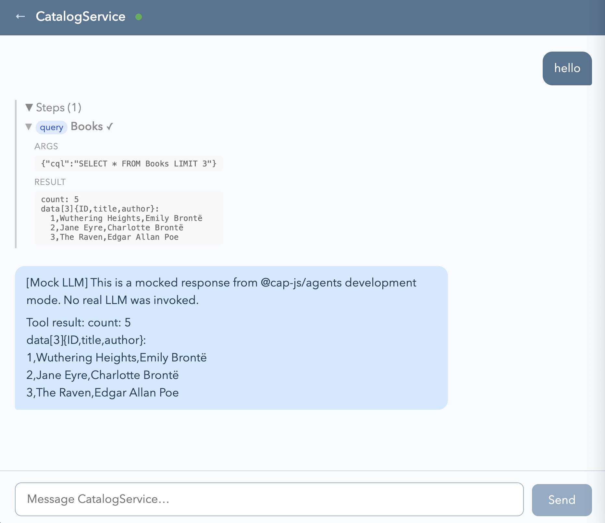

# Create an agent from a CAP service

<!-- description --> Learn how simple it is to create an agent based on a CAP service.

## You will learn

- How to turn a CAP service in to a fully functioning agent with a single
  annotation

## Prerequisites

You will need a development environment for CAP Node.js. See the tutorial [Set
up a self-contained development environment for CAP
Node.js](https://developers.sap.com/tutorials/cap-self-contained-dev-env.html)
The assumptions in this tutorial are based on option 1 or option 2 in that
tutorial, in that you have a VS Code (or GitHub Codespace) environment based on
the foundation repository used in the setup described there, which also means
that your starting directory will be `/workspaces/cap-nodejs-dev-env`. If you
have your own CAP Node.js development environment setup, then please make the
appropriate adjustments where necessary.

## Intro

The agentic AI era is truly upon us. Agents, as independent self-contained
units of reasoning & acting towards a goal, accessed via natural language
conveyed over the open agent-to-agent (A2A) protocol, are important components.

There are many ways to create agents, but perhaps one of the most
straightforward, especially in the context of a service that we want an agent
to help us with and be an expert in, is to use CAP and the `@agent` annotation.

---

### Set up a simple CAP service

To have a service from which we can create an agent, let's set up a very
simple CAP project with a basic "books" oriented service. Conveniently there's
the `tiny-sample` facet which we can use.

👉 Create a new CAP project using this facet, plus the `nodejs` facet:

```bash
cds init --add tiny-sample,nodejs cap-create-agent
```

> We're adding the `nodejs` facet so that we have a `package.json` file,
> as we'll be installing a package with `npm` later.

👉 Now open the new `cap-create-agent/` directory in a new VS Code /
Codespace window:

```shell
code cap-create-agent/
```

This should place you and any new terminal session in the new
`cap-create-agent/` directory.

There's a simple `CatalogService` with a single `Books` entity, for which
there are a handful of records. Let's have a quick look.

👉 Start the server with `cds watch`, which should cause log lines as shown
below to be emitted:

```log
[cds] - loaded model from 1 file(s):
 
  srv/cat-service.cds

[cds] - using bindings from: { registry: '~/.cds-services.json' }
[cds] - connect to db > sqlite { database: ':memory:' }
  > init from db/data/CatalogService.Books.csv 
/> successfully deployed to in-memory database. 

[cds] - serving CatalogService {
  at: [ '/odata/v4/catalog' ],
  decl: 'srv/cat-service.cds:1'
}
[cds] - server listening on { url: 'http://localhost:4004' }
```

> The path on which `CatalogService` is served - `/odata/v4/catalog` - indicates
> that this is OData v4.

### Add the agents plugin

The agentic facilities that we can summon with the use of a single annotation
are provided in the form of a plugin.

👉 Stop the currently running CAP server (with `Ctrl-C`) and add that plugin
now:

```shell
npm add @cap-js/agents@0.9.8
```

This will cause the installation of quite a few packages. Beneath the calm
surface of the CAP framework, which allows us to [work
declaratively](https://qmacro.org/blog/posts/2026/01/27/constraints-expressions-and-axioms-in-action/)
and [use the power of the
framework](https://qmacro.org/blog/posts/2024/11/07/five-reasons-to-use-cap/)
rather than write (or, worse, generate) more code ourselves, the heavy lifting
is being done for us, with extra features too for local-first development.

👉 Take a quick peek at those packages, upon which the `@cap-js/agents` package
depends:

```shell
npm info @cap-js/agents dependencies
```

This should emit something like this:

```json
{
  zod: '^4.0.0',
  marked: '^18',
  langchain: '^1.5.0',
  deepagents: '^1.10.0',
  '@a2a-js/sdk': '^0.3.12',
  '@cap-js/mcp': '^1.5',
  '@langchain/core': '^1',
  '@langchain/openai': '^1.5.13',
  '@cap-js/attachments': '>=3',
  '@langchain/anthropic': '^1.5.1',
  '@langchain/langgraph': '^1',
  '@sap-ai-sdk/langchain': '^2.13.0',
  '@langchain/mcp-adapters': '^1.1.3',
  '@sap-ai-sdk/orchestration': '^2.11.0',
  '@sap-cloud-sdk/http-client': '^4.9.1',
  '@sap-cloud-sdk/connectivity': '^4.7.0'
}
```

### Add an @agent annotation

The CDS model for this service is deliberately very simple and defined in a
single file, `srv/cat-service.cds`.

👉 Add an `@agent` annotation so that it looks something like this:

```cds
@agent
@odata
service CatalogService {
  entity Books {
    key ID     : Integer;
        title  : String;
        author : String;
  }
}
```

### Restart the CAP server

Now restart the CAP server, this time specifying the `agents` component in the
`DEBUG` environment variable, so that we can get to see the details of what's
happening:

```shell
DEBUG=agents cds watch
```

This time there's more in the CAP server log, which now looks something like
this:

```log
[cds] - loaded model from 5 file(s):

  srv/cat-service.cds
  node_modules/@cap-js/agents/srv/entities.cds
  node_modules/@cap-js/attachments/index.cds
  node_modules/@cap-js/attachments/db/index.cds
  node_modules/@sap/cds/common.cds

[cds] - using bindings from: { registry: '~/.cds-services.json' }
[cds] - connect to db > sqlite { url: ':memory:' }
  > init from db/data/CatalogService.Books.csv
  > init from node_modules/@cap-js/attachments/db/data/sap.attachments-ScanStates_texts.csv
  > init from node_modules/@cap-js/attachments/db/data/sap.attachments-ScanStates.csv
/> successfully deployed to in-memory database.
...
[cds] - serving CatalogService {
  at: [ '/odata/v4/catalog', '/a2a/catalog' ],
  decl: 'srv/cat-service.cds:2'
}
[agents] - Failed loading Claude settings from ~/.claude/settings.json
[agents] - Failed loading OpenCode settings from ~/.config/opencode/opencode.json
[agents] - Failed loading Codex settings from ~/.codex/config.toml
[agents] - Failed loading OpenCode settings from ~/.config/opencode/opencode.json
...
[cds] - server listening on { url: 'http://localhost:4004' }
...
```

👉 Take a moment to [stare
at](https://qmacro.org/blog/posts/2017/02/19/the-beauty-of-recursion-and-list-machinery/#initial-recognition)
this output. It shows us quite a few interesting things:

- The simple model is now extended via both the `@cap-js/agents` plugin that we
  added explicitly, and via further plugins that were also installed as
  dependencies.
- There are some corresponding CSV files included in initial data loading too.
- The `CatalogService` is now also served at `/a2a/catalog`

Additionally:

- The debug output for the `agents` component shows the default [automatic
  config](https://cap.cloud.sap/docs/guides/ai/cap-agents#automatic-config)
  feature which looks for LLM configuration in places that may exist on your
  local machine, if you use tools such as Claude Code, OpenCode or similar.

    > If you're using a self-contained development environment as described in
    > the prerequisites, then it's unlikely that you'll have configuration like
    > this, so you will probably also see the "Failed loading" debug log records
    > as shown here.

### Check the CAP server welcome page

👉 Head over to the CAP server welcome page at `http://localhost:4004` via the
URL in the log output, where there should be two service endpoints for the
catalog service - one where it's served via the OData protocol, and one where
it's served via the A2A protocol.

An agent!


### Explore the two standard A2A endpoints

👉 Explore the first two resources listed for the agent service endpoint:

- `/a2a/catalog` is the root resource for the A2A endpoint for this agent. A2A
  uses JSON-RPC which, while readable (the representations are JSON), is
  somewhat unfriendly to humans as the protocol uses HTTP `POST` predominantly.
  This is why an error is returned when you `GET` the resource by visiting it
  in the browser:

    ```json
    {
      "jsonrpc": "2.0",
      "error": {
        "code": -32000,
        "message": "Method not allowed."
      },
      "id": null
    }
    ```

- `Agent Card` is a "well-known" resource in the A2A protocol and [describes an
  agent's capabilities](https://agent2agent.info/docs/concepts/agentcard/).
  Notably, this includes a `skills` property which looks like this, for the
  `CatalogService`:

    ```json
    {
      "name": "CatalogService",
      "description": "Agent for CatalogService",
      "url": "http://localhost:4004/a2a/catalog",
      "...": "...",
      "skills": [
        {
          "id": "query",
          "name": "Data Query",
          "description": "Query data from the service. Available entities: \n Books",
          "examples": [
            "Show me all Books"
          ],
          "tags": [
            "query",
            "data",
            "read",
            "books"
          ]
        }
      ]
    }
    ```

### Explore the Preview facility in mock LLM mode

To finish off our first foray into the agentic world with CAP-level agents, 
we'll explore the third resource listed for the agent service endpoint, namely
the "Preview", a [simple and experimental chat preview for local development
use](https://cap.cloud.sap/docs/guides/ai/cap-agents#using-chat-preview).

We'll explore it in pure local-first development mode, and [in line with many
other mocking
facilities](https://qmacro.org/blog/posts/2026/05/11/local-first-dev-with-cap-node-js/),
there's a "mock LLM" facility which we'll make use of here.

👉 First, stop the current CAP server (with `Ctrl-C`).

👉 Next, restart it, specifying `mock` as the value for the LLM requirement:

```shell
cds_requires_llm_kind=mock cds watch
```

> Using snake case names that represent nodes in the [effective
> environment](https://cap.cloud.sap/docs/node.js/cds-env#cli) is one of many
> ways we can provide values like this; alternatives would be to use a file
> like `.cdsrc.json` or `.env`, or put the configuration directly into
> `package.json`.

Amidst the normal CAP server log output, we should see something like this:

```log
[agents] - cds.connect.to 'llm' with: {
  impl: '@cap-js/agents/lib/models/mock',
  kind: 'mock',
  credentials: {}
}
```

The Preview facility is now ready for us with a mocked LLM, which responds the
same way each time, to whatever we send in chat. Here's an example:



What's happened is that we get a full chat roundtrip, without having to have a
connection to a real LLM.

Nice!

To finish off, stop the CAP server with `Ctrl-C`.

### Wrap-up and further info

For more information:

- CAP-level agents are covered in Capire's [Native
  AI](https://cap.cloud.sap/docs/guides/ai/cap-agents) guide

In the next tutorial [Connect a CAP-level agent to an
LLM](https://developers.sap.com/tutorials/cap-connect-agent-to-llm) we connect
this agent to a real LLM and put it through its paces.

As described in the [CAP-level agents configuration in
Capire](https://cap.cloud.sap/docs/guides/ai/cap-agents#configuration), we see
that while the `mock` LLM kind is available for pure local-first development,
the default kind of LLM for development is `auto`, which attempts to use local
agent harness tooling configuration for an LLM connection.
