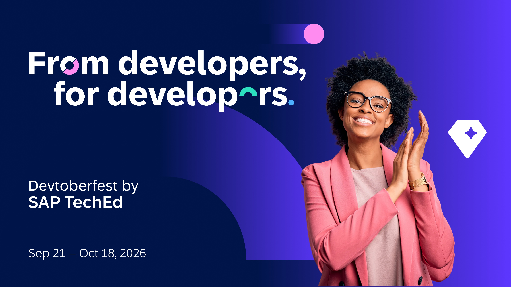

# 🟠 Devtoberfest 2026 - Week 4 - Validation Tutorial - Building Apps Week 4 (available after last session)

<!-- description --> This is the validation tutorial so you can get Devtoberfest points for watching the 🟠 Building Apps sessions for week 4.

## You will learn

- A lot about technology and yourself during Devtoberfest

## Intro

This tutorial is part of our yearly and wonderful **Devtoberfest**, a month-long event filled with learning, fun, challenges, and prizes -- for developers by developers.

For more info on Devtoberfest, see our [Devtoberfest page](https://developers.sap.com/devtoberfest).

### Question 1 - 🟠 AI Assisted CAP Development

&nbsp;
<iframe width="560" height="315" src="https://www.youtube.com/embed/2OejfBst0zU" frameborder="0" allowfullscreen></iframe>

### Question 2 - 🟠 CAP in the era of AI: Agents and MCP Servers

&nbsp;
<iframe width="560" height="315" src="https://www.youtube.com/embed/X5cFgDkN-d8" frameborder="0" allowfullscreen></iframe>

### Question 3 - 🟠 SAP Meets the Agentic Web: CAP MCP - UI5 WebMCP

&nbsp;
<iframe width="560" height="315" src="https://www.youtube.com/embed/tns_f_Yqi2w" frameborder="0" allowfullscreen></iframe>

### Question 4 - 🟠 AI-Assisted SAP Development with MCP

&nbsp;
<iframe width="560" height="315" src="https://www.youtube.com/embed/b6eGA00UpkI" frameborder="0" allowfullscreen></iframe>

### Question 5 - 🟠 Agentic UI Extensibility: The Next Chapter of SAPUI5 Flexibility

&nbsp;
<iframe width="560" height="315" src="https://www.youtube.com/embed/90cGm6RYJ2Y" frameborder="0" allowfullscreen></iframe>
